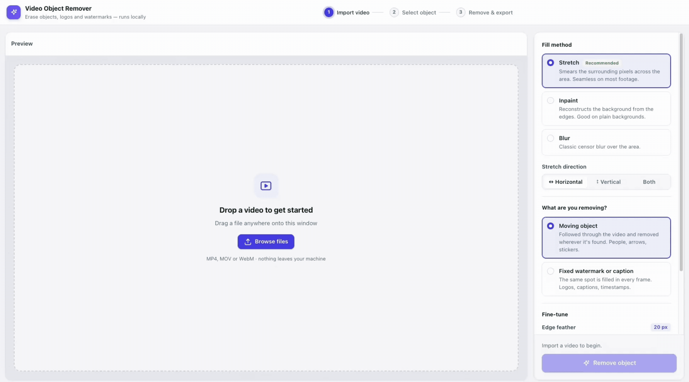

<h1 align="center">Video Object Remover</h1>

<p align="center">
  A local video-editing tool for selecting an object with a lasso or rectangle and removing it
  throughout a video with tracking, stretch fill, inpainting, or blur.
</p>

<p align="center">
  
  
  
  
  
</p>

<p align="center">
  <a href="#overview">Overview</a>
  ·
  <a href="#getting-started">Getting Started</a>
  ·
  <a href="#user-workflow">User Workflow</a>
  ·
  <a href="#architecture">Architecture</a>
  ·
  <a href="#api-reference">API Reference</a>
  ·
  <a href="#deployment">Deployment</a>
</p>

<br />

<p align="center">
  
</p>

## Overview

Video Object Remover is a self-hosted browser tool for hiding an object, watermark, logo,
caption, or other unwanted region in a video. The user uploads a video, chooses a frame where the
object is visible, draws a polygon or rectangle around it, and previews the fill directly in the
browser before rendering the final MP4.

The project is intentionally local-first:

- Uploaded videos and rendered outputs stay in the project’s `uploads/` and `outputs/` folders.
- The browser communicates with a local FastAPI server over HTTP.
- Processing uses OpenCV and NumPy; no cloud vision or external storage service is required.
- The original audio is retained when the processed video is encoded.

The current application includes:

- Drag-and-drop upload for MP4, MOV, WebM, and other formats supported by the installed codecs
- Frame-accurate playback and frame navigation
- Lasso and rectangle selection tools
- Live browser preview while the video is playing
- Exact server-side preview while paused
- Moving-object tracking across shots
- Fixed-region mode for watermarks, logos, and captions
- Stretch, OpenCV Telea inpaint, and blur fill modes
- Horizontal, vertical, or combined stretch directions
- Edge feathering and patch softness controls
- Optional in/out frame range
- Background progress reporting and cancellation for analysis and rendering
- MP4 download with H.264 video and original audio

## Tech stack

- **Python 3.9+** — application runtime
- **FastAPI** — HTTP API, request validation, static-file serving, and upload handling
- **Uvicorn** — ASGI development and production server
- **OpenCV / opencv-contrib-python** — video decoding, masks, morphology, inpainting, image
  operations, histogram analysis, and tracking helpers
- **NumPy** — vectorized pixel and mask calculations
- **imageio-ffmpeg** — provides the FFmpeg executable used for accurate frame reads and final
  H.264 encoding
- **Pydantic** — validation for fill, tracking, and processing request bodies
- **HTML, CSS, and vanilla JavaScript** — the single-page editor in `static/index.html`

## Requirements

- Python 3.9 or newer
- `pip`
- A modern browser with HTML5 video and Canvas support
- Enough disk space for the uploaded source video and rendered output
- Enough memory for the low-resolution in-memory index; larger or longer videos require more RAM

FFmpeg does not need to be installed separately: `imageio-ffmpeg` supplies a platform-specific
binary. OpenCV still needs to be able to decode the uploaded video format.

## Getting started

From the project directory:

```bash
python3 -m venv .venv
source .venv/bin/activate
pip install -r requirements.txt
python app.py
```

Open [http://127.0.0.1:8000](http://127.0.0.1:8000).

On Windows, activate the virtual environment with:

```powershell
.venv\Scripts\Activate.ps1
```

The application binds to `127.0.0.1` by default and runs without reload mode:

```bash
python -m uvicorn app:app --host 127.0.0.1 --port 8000
```

To make the server reachable from another device on a trusted local network, explicitly choose
the bind address:

```bash
python -m uvicorn app:app --host 0.0.0.0 --port 8000
```

This should only be done on a trusted network. The current application has no authentication,
per-user isolation, upload quotas, or automatic cleanup.

## Available commands

| Command | Description |
| --- | --- |
| `python app.py` | Start the local FastAPI server on port 8000 |
| `python -m uvicorn app:app --host 127.0.0.1 --port 8000` | Start the server explicitly through Uvicorn |
| `pip install -r requirements.txt` | Install runtime dependencies |

There is currently no automated test suite, formatter, or type-check script in the repository.
For a basic smoke check after installation, start the server and open the root page:

```bash
curl -I http://127.0.0.1:8000/
```

## User workflow

### 1. Upload a source video

Drop a video onto the page or use the file picker. The browser begins local playback immediately
while `POST /api/upload` stores a copy under `uploads/` and returns metadata plus the first frame.
The server starts building a low-resolution analysis index in the background at the same time.

### 2. Choose the source frame and draw a selection

Play or scrub to a frame where the unwanted object is easy to see. Use:

- **Lasso** (`L`) to draw a free-form polygon
- **Rectangle** (`R`) to draw a rectangular region
- **Escape** to clear the current selection
- **Space** to play or pause
- **Left / Right arrows** to move one frame at a time

The selection is drawn in video coordinates even when the canvas is scaled to fit the workspace.

### 3. Preview the removal

The browser applies a JavaScript version of the fill for responsive playback. When paused, the
client can request an exact server-side preview through `POST /api/preview`. The **Compare**
control temporarily reveals the original frame.

### 4. Choose tracking behavior

Use **Moving object** when the selected object moves. The server tracks the selection forward and
backward from the chosen frame and searches other shots when the object is clearly present. The
green strip under the seek bar indicates the frames with a usable tracked selection.

Use **Fixed watermark, logo or caption** when the same screen region should be filled on every
frame. This is the recommended mode for semi-transparent overlays whose visible appearance changes
with the footage behind them.

Use **In** and **Out** to restrict the final removal to an inclusive frame range.

### 5. Select a fill method

| Method | Best for | How it works |
| --- | --- | --- |
| **Stretch surrounding pixels** | Text, arrows, logos, and overlays | Interpolates neighboring pixels across the mask horizontally, vertically, or in both directions |
| **Inpaint** | Small objects on relatively plain backgrounds | Uses OpenCV Telea inpainting, followed by light smoothing |
| **Blur only** | Censoring when reconstruction is not required | Applies a Gaussian blur inside and around the mask |

**Edge feather** grows the mask beyond the drawn selection and softens the boundary. **Softness**
controls smoothing inside the filled patch.

### 6. Render and download

Click **Remove object**. The server optionally tracks the selection, renders frames sequentially,
encodes the result as MP4, and exposes **Preview result** and **Download MP4** when complete.
The render job can be cancelled from the UI.

## Architecture

The application has three layers:

```text
Browser editor (static/index.html)
        │
        │ JSON requests, JPEG data URLs, job polling
        ▼
FastAPI application (app.py)
        │
        ├── uploads/ and outputs/ filesystem storage
        ├── background index, tracking, and render threads
        ▼
Video processing pipeline (remover.py)
        │
        ├── OpenCV + NumPy frame and mask operations
        └── imageio-ffmpeg / FFmpeg decode and H.264 encode
```

### Frontend layer

`static/index.html` is a self-contained editor. It owns the player, canvas overlays, controls,
selection geometry, keyboard shortcuts, preview state, tracking visualization, progress polling,
and result playback. It draws frames to a canvas so the original video can remain hidden beneath
the editable preview. The client-side fill mirrors the server’s stretch and blur behavior closely
enough for interactive playback; the server remains authoritative for the final output.

### API and job layer

`app.py` creates the FastAPI application, mounts static and output directories, validates request
bodies with Pydantic, and coordinates long-running work:

1. Uploads are assigned random hexadecimal IDs and written to `uploads/`.
2. A `VideoIndex` build starts in a daemon thread after a valid first frame is read.
3. Tracking and processing receive job IDs and run in daemon threads.
4. The browser polls job status and receives stage names such as `analyzing`, `tracking`, and
   `rendering`.
5. Completed outputs are written to `outputs/<job_id>.mp4`.

Jobs and indexes are held in process memory. `jobs` is protected by `jobs_lock`; the index cache
uses an insertion-ordered cache limited to two videos because each entry stores compressed frames
for the whole video.

### Processing layer

`remover.py` contains the video algorithms:

1. `video_meta` reads FPS, dimensions, and frame count.
2. `read_frame` uses FFmpeg accurate seeking rather than relying on OpenCV frame seeking, which
   can land on the wrong frame for some H.264 files.
3. `polygon_to_mask` rasterizes the selection and applies edge dilation.
4. `fill_region` dispatches to stretch, inpaint, or blur and blends the result through a feathered
   alpha mask.
5. `estimate_object_mask` compares the selection with a surrounding color ring to distinguish the
   object from background pixels.
6. `VideoIndex` decodes the video once at a bounded resolution, stores JPEG-compressed frames in
   memory, and identifies hard cuts, dissolves, and flashes using color histograms and structure.
7. `_TemplateTracker` and `track_object` follow the object using masked color similarity and
   normalized cross-correlation, while avoiding shot cuts and lost-object false positives.
8. `remove_object` reads the source sequentially, places the mask per frame, fills the region, and
   streams frames to FFmpeg. Temporal blending is used only when the mask and surroundings remain
   static, reducing flicker without ghosting over moving footage.

## API reference

All endpoints are served by the local FastAPI app. Request bodies are JSON unless noted otherwise.

| Method | Endpoint | Purpose |
| --- | --- | --- |
| `GET` | `/` | Serve the editor page |
| `POST` | `/api/upload` | Save an uploaded video, return metadata and the first frame, and start indexing |
| `GET` | `/api/frame/{video_id}?index=N` | Return one frame as a JPEG data URL |
| `POST` | `/api/preview` | Apply a fill to one frame for exact paused-frame feedback |
| `POST` | `/api/track` | Start an asynchronous object-tracking job |
| `GET` | `/api/track/{job_id}` | Return tracking progress and tracked boxes when complete |
| `POST` | `/api/process` | Start an asynchronous final render job |
| `GET` | `/api/status/{job_id}` | Return public job status, stage, progress, output, and error |
| `POST` | `/api/cancel/{job_id}` | Request cancellation of a tracking or processing job |
| `GET` | `/api/download/{job_id}` | Download a completed MP4 as `object_removed.mp4` |

The main fill request accepts these fields:

```json
{
  "video_id": "upload-id",
  "points": [[320, 180], [520, 180], [520, 340], [320, 340]],
  "start_frame": 120,
  "mode": "stretch",
  "direction": "horizontal",
  "feather_px": 20,
  "blur_ksize": 41
}
```

`mode` is `stretch`, `inpaint`, or `blur`. `direction` is `horizontal`, `vertical`, or `both`.
`points` must contain at least three points. Processing additionally accepts `track`, an optional
`track_id`, and an inclusive `frame_range` pair.

## Project structure

```text
.
├── app.py                         # FastAPI app, routes, jobs, uploads, and output serving
├── remover.py                     # Masks, fill algorithms, indexing, tracking, and rendering
├── requirements.txt               # Python runtime dependencies
├── preview.gif                    # README demonstration asset
├── static/
│   └── index.html                 # Single-page editor: markup, styles, and client logic
├── uploads/                       # Runtime source videos (created/used locally)
└── outputs/                       # Runtime rendered MP4 files (created/used locally)
```

The checked-in `uploads/` and `outputs/` directories may contain local runtime artifacts. Do not
publish user videos or generated outputs accidentally; add an appropriate ignore rule before
sharing the project or deploying it as a public repository.

## Storage and lifecycle

- Uploads use UUID-derived hexadecimal IDs and preserve the original file extension.
- Outputs use the processing job ID as the filename.
- The process does not currently expire jobs, delete old uploads, or prune old outputs.
- Restarting the server clears in-memory jobs and index entries, but files remain on disk.
- A single process is assumed. Multiple worker processes would not share job dictionaries or index
  caches and are not supported without moving job state to a shared store.

## Performance considerations

- Video indexing decodes sequentially and stores a compressed, downscaled copy in memory.
- Index resolution is selected from the source dimensions and frame count to bound memory use.
- Tracking runs on the low-resolution index, while final filling runs against full-resolution frames.
- Final rendering is sequential and can be CPU- and disk-intensive for large videos.
- Accurate single-frame preview uses FFmpeg subprocesses and is intentionally separate from the
  sequential final render path.

## Limitations and quality guidance

Stretch fill is strongest for overlays, text, arrows, logos, and small regions where neighboring
background colors continue naturally. It can look like a smear when removing a large object from a
detailed, moving background. Telea inpainting is useful for small objects on simple backgrounds but
is not a temporal video-inpainting model.

Tracking can stop when the object is lost, when a scene changes, or when confidence is too low.
Frames without a confident tracked box are left untouched. For high-quality reconstruction of
large moving objects, the existing mask and tracking outputs could be passed to a dedicated
temporal inpainting model such as
[ProPainter](https://github.com/sczhou/ProPainter) or E2FGVI.

## Deployment

For a local or single-user deployment:

```bash
python3 -m venv .venv
source .venv/bin/activate
pip install -r requirements.txt
python -m uvicorn app:app --host 127.0.0.1 --port 8000
```

For a trusted LAN-only deployment, bind to `0.0.0.0` and place the service behind a firewall. For
public deployment, add authentication, upload size and duration limits, file-type validation,
resource quotas, cleanup policies, HTTPS, and a shared job store before exposing the API.

The application serves output files through `/outputs` and does not include a production reverse
proxy, persistent database, task queue, or multi-user access control.

## Development notes

- Keep frame operations in `remover.py` so the browser and API orchestration remain separate from
  image-processing algorithms.
- Preserve sequential decoding for final rendering; random OpenCV seeks are not reliable for every
  H.264 source.
- Keep client preview behavior aligned with server fill options so the paused preview and final
  render remain predictable.
- When changing request models, update both the API implementation and the corresponding controls
  in `static/index.html`.
